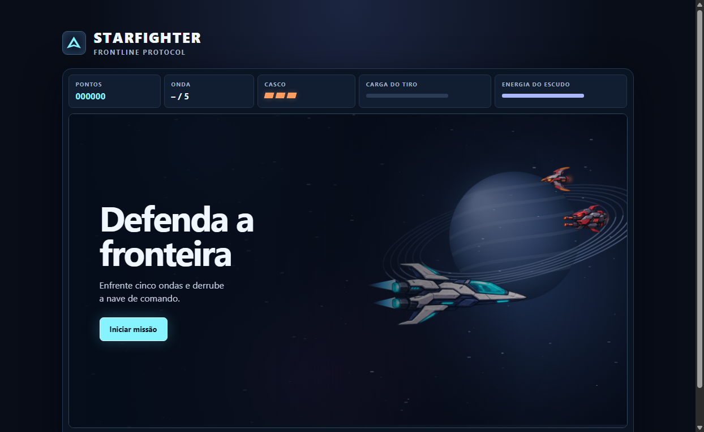

# Starfighter: Frontline Protocol

Jogo acadêmico de nave 2D com rolagem horizontal e combate em tempo real,
inspirado em clássicos como **R-Type**. Desenvolvido para a disciplina de
Sistemas Operacionais, o jogo usa threads e semáforos no motor Python e
renderiza a partida em Canvas no navegador.



## Executar o jogo

Você precisa de **Python 3.10 ou superior** e um navegador. O jogo usa apenas a
biblioteca padrão do Python.

Para baixar o projeto pela primeira vez, clone o repositório.

```bash
git clone https://github.com/Matthaus05/rtype-sistemas-operacionais.git
cd rtype-sistemas-operacionais
```

Na pasta do projeto, inicie o servidor local.

```powershell
python web_app.py
```

Abra [http://127.0.0.1:8000](http://127.0.0.1:8000) e clique em **Iniciar
missão**. Para encerrar o servidor, pressione `Ctrl+C` no terminal.
Se já houver uma instância do jogo na porta `8000`, encerre-a antes de
iniciar a nova.

Se o Windows abrir a Microsoft Store ao chamar `python`, execute o
`python.exe` da sua instalação pelo caminho completo. Para a instalação
padrão do Python 3.12 no perfil do usuário, use este comando.

```powershell
& "$env:LOCALAPPDATA\Programs\Python\Python312\python.exe" web_app.py
```

## Como jogar

Atravesse cinco ondas de inimigos e derrote o chefe. Você tem três pontos de
casco. Desvie dos inimigos e dos projéteis, use o escudo e carregue o canhão
para causar mais dano.

| Controle | Ação |
| --- | --- |
| Setas ou `W`, `A`, `S`, `D` | Mover a nave em quatro direções |
| `Espaço` | Atirar. Segure e solte para disparar um tiro carregado. |
| `Shift` | Ativar o escudo enquanto houver energia |

Em telas sensíveis ao toque, use os botões abaixo do campo de jogo.

## Threads e semáforos

O servidor HTTP leva os comandos do navegador ao motor da partida e devolve
uma cópia do estado para o Canvas. O `FlightController` coordena duas threads
de trabalho.

- **Simulação.** Atualiza movimento, rolagem, projéteis, colisões, pontuação e
  resultado da missão em passos fixos de 60 Hz.
- **Produção de ondas.** Aguarda um pedido da simulação, prepara a formação de
  inimigos e sinaliza que a onda está pronta.

O semáforo `_wake` acorda a simulação ao iniciar a missão ou encerrar o
servidor. O par `_wave_requested` e `_wave_created` sincroniza o pedido da
onda e a entrega da formação. Um lock protege o estado compartilhado
enquanto ele é atualizado ou copiado para o navegador.

## Arquivos do projeto

| Arquivo | Função |
| --- | --- |
| [`flight.py`](flight.py) | Motor da missão em tempo real |
| [`web_app.py`](web_app.py) | Servidor local e comunicação com o navegador |
| [`web/index.html`](web/index.html) | Interface, controles e renderização em Canvas |
| [`web/ships.png`](web/ships.png) | Sprites originais do jogador, dos inimigos e do chefe |
| [`game.py`](game.py) | Protótipo de turnos, executável com `python game.py` |

## Testes

```powershell
python -m unittest discover -s tests -v
```

Os testes cobrem a simulação 2D, os controles, o carregamento dos sprites pelo
servidor HTTP e o protótipo de turnos.

## Apresentação PIT

O [roteiro da apresentação PIT](docs/apresentacao-pit.md) reúne os slides, a
fala de apresentação e os passos para a demonstração ao vivo.
